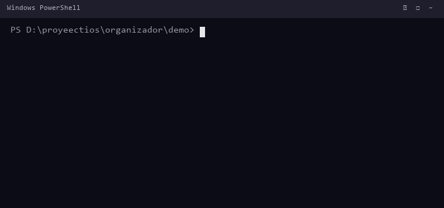

# Organizador de Archivos

Organizador ligero para Windows (`.exe`, C++17, sin dependencias) que mueve
archivos sueltos de una o varias carpetas de origen a
`<destino>\<Categoría>\<Año>\<Mes>`, clasificándolos por extensión y, si la
extensión es desconocida o falta, por el contenido (magic bytes).

## Características

- Una sola pasada o modo vigilante con icono en la **bandeja del sistema** (`--watch`).
- Clasificación por extensión y, como respaldo, por contenido real del archivo.
- Coloca cada archivo en `Categoría\Año\Mes` (configurable) usando la fecha de
  **creación** local del archivo (configurable a modificación).
- Anticolisión: si ya existe un archivo con el mismo nombre, añade `_1`, `_2`, ...
- No toca archivos en curso de escritura (tamaño/edad estable) ni ocultos/sistema.
- Lista de `proteccion` con comodines (`*`, `?`) y extensiones excluidas
  (`.part`, `.crdownload`, `.tmp`, `.lnk`, `.url`).
- Log de movimientos (`movimientos.json`) con `--deshacer` para revertir el
  último lote. Los movimientos cuyo destino ya no existe se descartan; los
  reintentables (origen ocupado o archivo bloqueado) siguen registrados.
- Es fail-closed: si `reglas.json` falta o es inválido, aborta (código 2) en vez
  de mover archivos sin reglas.
- `--selftest` ejecuta pruebas internas (patrones, JSON, anticolisión, etc.).
- Se compila como app de ventanas: **no** muestra consola en la barra de tareas
  (si se lanza desde una consola, se adjunta a ella e imprime igual).

## Demo (`--dry-run`)



```text
[SIMULACIÓN] --dry-run: no se moverá ningún archivo.
Destino base: D:\Archivos_Organizados
  -> Imágenes\2026\10 / foto.jpg
  -> Documentos\2026\10 / informe.pdf
  -> Documentos\2026\10 / notas.txt
  -> Comprimidos\2026\10 / paquete.zip
  -> Instaladores\2026\10 / setup.exe

Resumen: movidos 0 | omitidos 0 | protegidos 0 | fallidos 0
```

## Requisitos

- Windows 10/11 (x64).
- Para compilar: MinGW-w64 (g++ con C++17 y `windres`).
- Para ejecutar el `.exe` compilado: **ninguno** (es estático, sin dependencias).

## Compilar

```bat
build.bat
```

Busca el compilador en este orden: variable `MINGW_BIN`, `D:\tools\mingw64\bin`,
o `g++`/`windres` en el `PATH`. Genera `organizador.exe` junto al código.

Verificación rápida:

```bat
organizador.exe --selftest
```

## Configuración (`reglas.json`)

Al ejecutarse, el programa busca `reglas.json` **junto al `.exe`**. Copia
`reglas.example.json` a `reglas.json` y ajústalo:

```bat
copy reglas.example.json reglas.json
```

Campos principales:

| Campo | Descripción | Por defecto |
|-------|-------------|-------------|
| `destinoBase` | Carpeta raíz de destino | `D:\Archivos_Organizados` |
| `origenes` | Carpetas a organizar | — |
| `subcarpeta` | `anio-mes`, `anio`, `origen` o `plano` | `anio-mes` |
| `usarFecha` | `creacion` o `modificacion` | `creacion` |
| `proteccion` | Patrones de archivos a no mover (comodines `*` `?`) | — |
| `excluirExtensiones` | Extensiones incompletas a ignorar | *(ninguna; ver `reglas.example.json`)* |
| `ignorarOcultosSistema` | Ignorar archivos ocultos/sistema | `true` |
| `edadMinimaSeg` | Edad mínima antes de mover un archivo | `2` |
| `esperaEstableMs` | Espera máxima a que se estabilice el tamaño | `2000` |
| `reintentos` / `esperaReintentoMs` | Reintentos ante archivos bloqueados | `5` / `300` |
| `categorias` | Lista `{nombre, extensiones}` | — |

## Uso

```bat
organizador.exe                          :: usa los orígenes de reglas.json
organizador.exe D:\Descargas             :: organiza esa carpeta
organizador.exe D:\Descargas --dry-run   :: simula, no mueve nada
organizador.exe --watch                  :: vigilante en bandeja
organizador.exe --deshacer               :: revierte el último lote
organizador.exe --selftest               :: pruebas internas
organizador.exe --help                   :: ayuda
```

### Modo vigilante (`--watch`)

Icono en la bandeja del sistema. Doble clic: *Organizar ahora*. Clic derecho:
menú con *Organizar ahora* / *Salir*. Solo puede haber una instancia (mutex
global). Para iniciarlo con un acceso directo, usa `crear_atajo.ps1`.

### Códigos de salida

| Código | Significado |
|--------|-------------|
| `0` | Correcto |
| `1` | Nada que deshacer / fallo de selftest |
| `2` | Configuración inválida o sin orígenes (fail-closed) |
| `3` | Uno o más archivos fallaron |

## Estructura del proyecto

```
organizador/
  organizador.cpp          Código fuente único (C++17)
  organizador.rc           Recurso del icono
  reglas.example.json      Configuración de ejemplo (plantilla)
  build.bat                Compilación (MinGW)
  make_icon.ps1            Regenera organizador.ico
  crear_atajo.ps1          Crea el acceso directo del vigilante
  CHANGELOG.md             Historial de versiones
```

## Licencia

MIT. Ver `LICENSE` en la raíz del repositorio.
